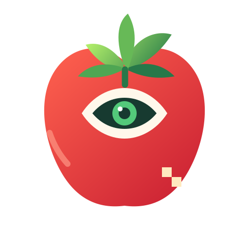

# TomatoAI

**Open, tomato-specialized intelligence for the complete growing cycle — from seedling to harvest.**

TomatoAI is a modular research and engineering project for building an AI system that can **observe, understand, monitor, predict, and help operate** a tomato-growing environment. It is designed to work with existing open-weight vision-language-action (VLA) models instead of reimplementing a general-purpose robotics foundation model from scratch.

The long-term target is a **mobile agricultural robot with an articulated arm**, RGB-D perception, environmental sensing, and a repeatable software stack for crop monitoring and carefully validated physical tasks.

> **Project status:** Initial architecture and documentation. Hardware integration, model selection, datasets, robot control, and field performance remain to be implemented and validated. This repository does not claim that autonomous cultivation or harvesting is already implemented.



## Vision

Build one tomato-specific intelligence layer that supports the entire crop lifecycle, while keeping perception, agronomic reasoning, navigation, manipulation, and low-level safety independently testable.

TomatoAI is **not just a tomato detector and not just a harvesting model**. Its intended scope includes:

- Plant establishment and growth-stage tracking
- Plant, leaf, stem, flower, and fruit detection/segmentation
- Fruit count, size, maturity, and progression over time
- Visual signs of disease, pests, nutrient deficiency, and stress, treated as candidate detections requiring validation
- Environmental and irrigation monitoring
- Anomaly detection, growth trends, and yield forecasting where data supports it
- Scouting, plant-by-plant records, and farm reporting
- Human-reviewed recommendations for irrigation, climate, nutrition, pruning, and other operations
- Mobile inspection and data collection
- Robot skills such as inspection and, only after safe validation, pruning or harvesting

TomatoAI should distinguish **observations, predictions, recommendations, and confirmed actions**. A visual suspicion is not a confirmed diagnosis, and an unvalidated forecast is not ground truth.

## What TomatoAI does

1. **Observe:** collect RGB/RGB-D images, optional thermal/multispectral images, sensor readings, robot pose, and timestamps.
2. **Perceive:** identify plants and plant parts; estimate spatial position and uncertainty.
3. **Associate over time:** link observations to a plant/row/zone only when tracking confidence is sufficient.
4. **Build plant state:** combine visual features, environment readings, and history into a structured, versioned record.
5. **Predict:** estimate likely changes only for outcomes supported by a measured validation protocol.
6. **Recommend:** propose inspection or cultivation actions with reasons, confidence, and a safe fallback.
7. **Plan:** turn approved goals into navigation, sensing, and manipulation tasks.
8. **Act:** execute through robot middleware and a task-specific policy, with limits, interlocks, and stop conditions.
9. **Verify:** record evidence of success, failure, or need for human review.

## System architecture

```text
   CAMERAS + ENVIRONMENTAL SENSORS + FARM HISTORY
                        |
                        v
               TOMATO PERCEPTION
       plant / leaf / flower / fruit / maturity
                        |
                        v
              TEMPORAL PLANT STATE
       plant identity, growth, health, uncertainty
                        |
           +------------+------------+
           |                         |
           v                         v
    AGRONOMIC ANALYTICS          TASK PLANNER
 growth / anomalies / yield   inspect / navigate /
 estimates / recommendations  measure / manipulate
           |                         |
           +------------+------------+
                        v
                 SAFETY SUPERVISOR
     limits / reachability / collision / e-stop /
        confidence / approval / action bounds
                        |
                        v
              OPEN VLA / ROBOT POLICY
         visual observation + task + robot state
                        |
                        v
                  ROS 2 + MOVEIT 2
        mobile base, articulated arm, end effector
                        |
                        v
                  TASK VERIFICATION
              logs, evidence, dataset updates
```

**Key boundary:** TomatoAI's plant-intelligence layer remains decoupled from the underlying VLA. The VLA is replaceable behind an adapter; plant state, datasets, evaluations, farm records, and safety policies should not depend on one model family.

## Mobile robot with articulated arm

The target is a **mobile base carrying an articulated manipulator**, not only a fixed harvesting arm.

### Physical subsystems

- **Mobile base:** greenhouse-appropriate platform, wheel encoders, motor controller, odometry, and a hardware emergency stop.
- **Articulated arm:** a 5–7 degree-of-freedom arm is a reasonable research target, subject to reach, payload, budget, and canopy geometry.
- **End effector:** replaceable compliant gripper, tomato gripper, pruning tool, or inspection tool. Each tool needs separate calibration and safety validation.
- **Primary camera:** RGB or RGB-D camera mounted to see the canopy and target plant.
- **Wrist camera:** optional close-up RGB/RGB-D camera for inspection and manipulation.
- **Navigation sensors:** lidar/depth, wheel odometry, and/or IMU according to platform needs.
- **Environmental sensors:** temperature, relative humidity, light/PAR, optional CO₂, and soil/substrate moisture/EC/pH where applicable.
- **Compute:** onboard CPU for ROS 2 and safety-relevant checks; edge/cloud GPU for inference or training. Network loss must not remove local stopping capability.

### Mobile operation sequence

1. Navigate to a row or zone.
2. Stop and stabilize before close inspection or arm movement.
3. Observe the plant and update its TomatoAI state.
4. Select an approved inspection or work task.
5. Check reachability, collision clearance, confidence, and safety conditions.
6. Execute with bounded speed/force.
7. Verify and log the outcome.
8. Retract to a known safe pose before the base moves again.

By default, **the base must not drive while the arm is extended**. Any exception needs a platform-specific hazard analysis. Manipulation must yield to a physical emergency stop and independent safety limits.

### Build in stages

Start with offline images and simulation; then a fixed camera; then a small arm on a bench; then a mobile base. Validate perception, manipulation, stopping, and recovery independently before combining them.

## Software architecture

Intended building blocks:

- **Python + PyTorch:** perception, data pipelines, training and evaluation.
- **ROS 2:** hardware interfaces, messaging, transforms, diagnostics, lifecycle nodes and robot integration.
- **MoveIt 2:** arm kinematics, planning scene and collision-aware motion planning.
- **Nav2:** mobile navigation when supported by the selected base.
- **Gazebo or a compatible simulator:** robot, sensors, greenhouse and task simulation.
- **Open VLA / robot-learning framework:** action policy behind a TomatoAI adapter.
- **Dataset/model registry:** provenance for data, weights, configurations, metrics and experiments.

The ROS 2 distribution, simulator, arm driver, camera driver and VLA framework must be selected together and pinned as a compatible deployment. One generic dependency file cannot safely cover every robot.

### Runtime boundaries

- Perception and plant analytics may run on an edge GPU or server.
- High-level planning returns structured proposals; it cannot bypass robot checks.
- Motion planning and actuation use local limits and collision checks.
- Emergency stop and motor-disable are hardware-backed and independent of cloud connectivity.
- Cloud training is separated from on-robot inference and operation.

## Model strategy

TomatoAI will **reuse an existing open/open-weight VLA as its action foundation**, then add tomato-specific modules and adapters. The foundation model is a dependency, not the identity of the project.

### Model layers

1. **Tomato perception:** detects/segments plants, leaves, flowers, stems and fruit; estimates maturity and visible anomalies.
2. **Temporal plant-state model:** aggregates observations and sensor history; handles missing values and uncertainty.
3. **Agronomic analytics:** separately evaluated models for growth trends, stress flags, fruit counts and yield estimates.
4. **Tomato task planner:** converts a goal and plant state into a typed task request.
5. **VLA policy:** proposes robot actions from visual observation and task context.
6. **Deterministic robot stack:** validates and executes eligible movements; the VLA cannot override safety controls.

### Training approach

- Start from compatible pretrained open weights.
- Establish a small, reliable perception benchmark before fine-tuning.
- Freeze most of the base VLA initially; train an adapter or action expert if supported.
- Fine-tune on real or simulated robot demonstrations with consistent camera, action, coordinate-frame, and robot-state conventions.
- Use teacher models to assist labeling only where terms allow; record provenance and review uncertain/high-impact labels.
- Expand coverage with simulation and augmentation but measure sim-to-real transfer separately.
- Split data by plant, capture session, greenhouse, or time where appropriate to prevent leakage.
- Promote models only when they improve a fixed benchmark and pass safety/regression checks.

Verify the exact model revision, license, commercial-use rights, hardware requirements, and fine-tuning support before choosing a base.

## Datasets and data governance

Combine datasets by capability rather than blindly merging folders.

| Data need | Candidate source / search direction | Intended use |
|---|---|---|
| Whole-plant growth, environmental readings and yield | Horti-M3-Tomato and comparable longitudinal horticulture datasets | temporal state and growth analytics |
| Greenhouse climate/control time series | Wageningen Autonomous Greenhouse Challenge tomato datasets | environment-to-outcome analysis |
| Tomato detection, ripeness and segmentation | public tomato maturity datasets from Zenodo or academic repositories | perception training and evaluation |
| Depth-aware tomato localization | BUTom21 and compatible RGB-D agricultural datasets | spatial grounding |
| Real robot interactions | tomato pruning/harvesting demonstrations, including DINO+CDP where available | manipulation-policy training |
| Field conditions | open-field tomato maturity and disease datasets | robustness outside controlled greenhouses |
| Project-specific data | TomatoAI robot logs and human-reviewed observations | domain adaptation and failure analysis |

These are candidate research leads, not a guarantee that a source is currently downloadable or licensed for every use. Before importing anything, record its source URL, version/date, license, permitted use, attribution requirements, annotation schema, known biases, and any privacy concerns. Large datasets and weights should generally live in external storage or a dataset hub, not Git history.

### Dataset onboarding checklist

- Name, publisher, canonical URL, version/access date
- License and permitted research/commercial/redistribution uses
- Attribution/citation requirements
- Modalities, sample count, sensor/calibration details
- Cultivars, environments, season and geography, when known
- Annotation format and known limitations
- Train/validation/test assignment and checksum
- Preprocessing version, privacy review, and owner approval

Do not split adjacent frames from the same video across training and test. Keep a locked test set and report greenhouse/field and lighting performance separately where possible. Teacher-generated labels are weak labels, not ground truth; record teacher revision and review important cases.

### Example plant observation

```json
{
  "schema_version": "0.1.0",
  "observation_id": "obs-example-0001",
  "timestamp_utc": "2026-01-01T12:00:00Z",
  "plant_id": "row-01-plant-0042",
  "observations": {
    "growth_stage": {"value": "fruiting", "confidence": 0.91},
    "fruit": {"visible_count": 17, "ripe_count": 4, "turning_count": 5, "green_count": 8}
  },
  "environment": {
    "air_temperature_c": null,
    "relative_humidity_pct": null,
    "substrate_moisture_pct": null
  },
  "uncertainty_flags": ["environment_readings_missing"],
  "model": {"name": "tomatoai-perception", "version": "0.1.0"}
}
```

Values are illustrative. Unknown measurements should remain null, not be guessed.

## Safety design

- Physical emergency stop and actuator-disable path independent of VLA, LLM, cloud, and ordinary ROS graph.
- Speed, joint, workspace, payload, and force limits.
- Collision checking and validated safe poses.
- Base/arm coordination interlock.
- Confidence thresholds, abstention, operator approval, and recovery behaviors.
- No autonomous pesticide/chemical application in the initial scope.
- No direct actuation from unvalidated natural-language output.
- Sensor freshness checks, watchdogs, and network-loss handling.
- Auditable logs for every proposal, rejection, execution and recovery.
- Bench, simulation, supervised greenhouse, then bounded autonomous testing.

Disease and nutrient-stress predictions are decision support, not definitive diagnoses. Irrigation and climate control should begin in advisory or human-approved mode.

## Suggested hardware classes

| Component | Baseline requirement | Selection notes |
|---|---|---|
| Mobile base | greenhouse-capable, encoder feedback, controllable velocity | measure aisle width, turning radius and stopping distance |
| Articulated arm | repeatable positioning, adequate reach/payload | 5–7 DoF target; test against canopy geometry |
| End effector | compliant and replaceable | minimize crushing fruit and damaging stems |
| RGB-D camera | synchronized RGB/depth and calibration support | range varies with lighting, distance and surface |
| Navigation sensors | lidar/depth plus odometry/IMU as needed | test repetitive rows and narrow aisles |
| Environment sensors | calibrated values with timestamps | depends on soil, substrate or hydroponic setup |
| Compute | ROS-capable CPU and optional GPU | deploy only after latency testing |
| Safety | physical E-stop, motor disable and interlocks | validate independently of AI |

This is a functional checklist, not a tested bill of materials. Choose hardware only after measuring the greenhouse, canopy, budget, reach, payload, cleaning needs and robot-driver support.

## Repository layout

```text
TOMATOAI/
├── README.md
├── LICENSE
├── assets/tomatoai-mark.svg
├── docs/
│   ├── ARCHITECTURE.md
│   ├── ROBOT_PLATFORM.md
│   ├── DATASETS.md
│   ├── SAFETY.md
│   └── MODEL_ADAPTERS.md
├── configs/
│   ├── tomato_state.schema.json
│   └── robot.example.yaml
├── tomatoai/
│   ├── perception/
│   ├── plant_state/
│   ├── analytics/
│   ├── planning/
│   ├── vla/
│   ├── interfaces/
│   └── evaluation/
├── ros2_ws/src/
├── simulation/
├── datasets/manifests/
├── training/
├── tests/
└── scripts/
```

This is the target layout. Add packages when they contain working code/tests instead of creating large numbers of empty placeholders.

## Development roadmap

### Phase 0 — contracts and reproducibility
- [ ] Define plant-state schema and coordinate-frame conventions
- [ ] Establish data/model manifest and license checklist
- [ ] Define fixed perception and task benchmarks
- [ ] Pin one reference software/model environment

### Phase 1 — visual TomatoAI
- [ ] Run inference on sample tomato images
- [ ] Detect/segment fruit and plant parts
- [ ] Estimate maturity and uncertainty
- [ ] Export structured plant-state JSON
- [ ] Establish held-out metrics and error analysis

### Phase 2 — temporal farm intelligence
- [ ] Track plants across observations
- [ ] Integrate environmental time series with missing-data handling
- [ ] Add growth and fruit-count trends
- [ ] Evaluate anomaly flags and forecasts on time-separated data
- [ ] Create monitoring reports

### Phase 3 — simulation and ROS 2
- [ ] Bring up simulated mobile base and articulated arm
- [ ] Validate transforms, calibration, navigation, joint limits and collision objects
- [ ] Define typed task/action messages
- [ ] Test emergency stop and recovery

### Phase 4 — supervised manipulation
- [ ] Collect teleoperated demonstrations
- [ ] Align observations, actions, robot state and timestamps
- [ ] Train/evaluate a VLA adapter or task policy
- [ ] Test slow, low-force movement with mock fruit
- [ ] Add approval and success verification

### Phase 5 — greenhouse trials
- [ ] Test scouting/monitoring first
- [ ] Evaluate navigation and plant association over rows
- [ ] Run supervised manipulation on real plants
- [ ] Measure success, damage rate, cycle time, recovery and uptime
- [ ] Expand autonomy only after validation

## Getting started

This initial repository contains architecture, schemas and configuration examples. A runnable training/robot environment will be added after choosing the reference hardware and base VLA.

```bash
git clone https://github.com/CMKIXVI/TOMATOAI.git
cd TOMATOAI
```

For the first milestone, start with offline images and structured plant-state output before connecting physical actuators. Select compatible, pinned versions of Linux, ROS 2, PyTorch/CUDA, MoveIt 2/Nav2, simulator and robot drivers together.

## Configuration example

See [configs/robot.example.yaml](configs/robot.example.yaml). All motion limits there are placeholders, not certified settings. Derive real limits from the actual robot, workspace, and hazard analysis before enabling motion.

## Evaluation

Use task-specific metrics:

- **Perception:** precision/recall, mAP, segmentation quality, maturity confusion matrix, performance by lighting/occlusion and confidence calibration.
- **Plant state:** counting error, plant association, repeat-visit stability, missing-data handling and forecast error.
- **Agronomic analytics:** anomaly precision/recall, forecast error/interval calibration and comparisons against simple baselines.
- **Navigation:** goal success, drift, clearance violations, interventions and recovery.
- **Manipulation:** task success, crop damage, collisions, dropped fruit, cycle time and recovery.
- **System:** end-to-end latency, uptime, power and behavior during network/sensor loss.

Every reported result must state its test-set definition, data version, model revision, configuration, trial count, and uncertainty. Label simulation results clearly.

## Contribution principles

- Keep adapters small and documented.
- Keep plant-state formats model-independent and versioned.
- Never commit secrets, private farm videos or large weights.
- Add tests for each interface or behavior change.
- Include provenance and license status for every dataset.
- Report failures and limitations as well as successful demonstrations.
- Do not enable a new physical action without limits, tests, and recovery.

## Licensing

An explicit repository license must be chosen before external reuse terms are clear. A repository license does not override the licenses of pretrained models, datasets, drivers, or third-party code. Check redistribution, commercial use, attribution and derivative-model restrictions individually.

---

**TomatoAI — Observe the plant. Understand the crop. Act with care.**
